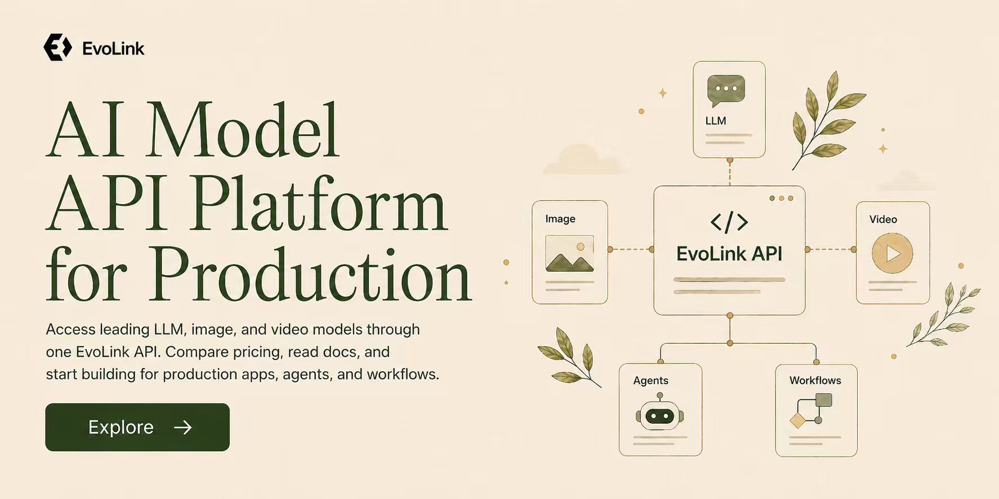

  

  
  
  
  

  <strong>EvoLink is the model access layer for AI teams shipping production apps, agents, and creative workflows.</strong>

## Unified API Ecosystem

| Category | Featured Models |
| :--- | :--- |
| **Text** |           |
| **Image** |           |
| **Video** |          |
| **Audio** |    |

[Browse all models](https://evolink.ai/models?utm_source=github&utm_medium=readme&utm_campaign=profile) · [Read API updates](https://evolink.ai/changelog?utm_source=github&utm_medium=readme&utm_campaign=profile)

## Build With EvoLink

- one API key across text, image, video, and audio model families
- OpenAI SDK compatible integration patterns
- async media-generation flows for long-running image, video, and audio jobs
- agent-friendly examples and installable skills for Codex, Claude Code, Cursor, and OpenClaw

  <a href="https://evolink.ai?utm_source=github&utm_medium=readme&utm_campaign=profile">Website</a>
  ·
  <a href="https://evolink.ai/docs/en/?utm_source=github&utm_medium=readme&utm_campaign=profile">Docs</a>
  ·
  <a href="https://evolink.ai/models?utm_source=github&utm_medium=readme&utm_campaign=profile">Models</a>
  ·
  <a href="https://discord.gg/5mGHfA24kn">Discord</a>
  ·
  <a href="https://x.com/EvoLinkAi">X</a>

Powered by EvoLink.

